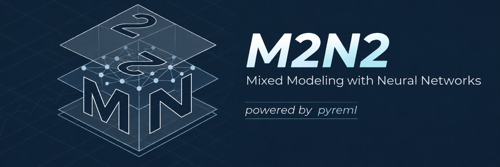

<h1 align="center">

</h1>

<p>
  Mixed modeling with neural networks, built on
  <a href="https://github.com/ai-for-genome-interpretation-lab/pyreml">
    </a>.
</p>

The random design of a linear mixed model is the embedding of a neural network, trained jointly with the fixed effects and the variance components on the REML loss.

## Installation

Install **m2n2** with `pip`:

```bash
pip install m2n2
```

## The model

**m2n2** fits a linear mixed model built upon the neural network $\nu$ of parameters $\theta$:

$$
y = X\beta + Z_G u_G + Z_S u_S + r
\qquad
z_i \mapsto \nu(z_i, \theta) \in \mathbb{R}^d
$$

- $X$: fixed effects design matrix, provided from a `patsy` formula.
- $\beta$: fixed effects.
- $z_i$: features of individual $i$ (e.g. SNPs).
- $Z_G = \nu(z, \theta)$: general design matrix, embedding of the features by the network of dimension $n \times d$.
- $Z_S = \bigoplus_{k=1}^{q} \nu(z_{(k)}, \theta)$: specific design matrix of dimension $n \times qd$ for the $q$ groups.
- $u_G \sim N(0, \sigma^2_G I), u_G \in \mathbb{R}^d$: general embedding effects.
- $u_S \sim N(0, \sigma^2_S I), u_{S} \in \mathbb{R}^{qd}$: group-specific embedding effects (optional).
- $r \sim N(0, \sigma^2_R I)$: residual.

## Example

```python
from functools import partial
import numpy as np
import matplotlib.pyplot as plt
import torch
import torch.nn as nn
from meiosim import Arabidopsis
from meiosim.Population import MISSING
from m2n2 import MixedModelNN

pop = Arabidopsis(n_SNPs=10_000, seed=42)
data = pop.phenotypes[["individual", "DTF1"]].merge(
    pop.metadata[["individual", "country"]], on="individual"
)

z = pop.genotypes.astype(np.float32)
z[z == MISSING] = np.nan
z = torch.tensor(np.where(np.isnan(z), np.nanmean(z, axis=0), z))

class Network(nn.Module):
    def __init__(self, z):
        super().__init__()
        self.register_buffer("z", z)
        self.body = nn.Sequential(
            nn.Dropout(0.1),
            nn.Linear(z.shape[1], 256), nn.BatchNorm1d(256), nn.GELU(), nn.Dropout(0.5),
            nn.Linear(256, 128), nn.BatchNorm1d(128), nn.GELU(), nn.Dropout(0.5),
            nn.Linear(128, 64),
        )

    def forward(self, rows=None):
        return self.body(self.z if rows is None else self.z[rows])

torch.manual_seed(42)
network = Network(z) # /!\ z and data must be perfectly aligned

model = MixedModelNN.from_dataframe(
    data,
    response="DTF1",
    Z=network,
    specificity="country",
    optimizer=partial(
        torch.optim.AdamW,
        lr=1e-3,
        weight_decay=1e-1
    ),
    lr_beta=1e-2,
    lr_var=1e-2,
)

model.fit(
    n_epoch=1000,
    batch_size=256,
    validation=0.2,
    patience=50,
    verbose=False,
)


fig, (ax_loss, ax_score) = plt.subplots(1, 2, figsize=(10, 3.5))
ax_loss.plot(model.loss)
ax_loss.set_xlabel("epoch")
ax_loss.set_ylabel("REML -2logLik")
ax_score.plot(model.score)
ax_score.axvline(np.argmin(model.score), color="grey", linestyle="--")
ax_score.set_xlabel("epoch")
ax_score.set_ylabel("validation MSE")
plt.show()

model.plot()

model.varcomp()
```

## Documentation

The documentation is available at [this address](https://ai-for-genome-interpretation-lab.github.io/m2n2).

## Code

The code is available at [this address](https://github.com/ai-for-genome-interpretation-lab/m2n2).

## License

Copyright © 2026 CNRS, University of Montpellier

This program is free software: you can redistribute it and/or modify it under the terms of the GNU General Public License as published by the Free Software Foundation, either version 3 of the License, or (at your option) any later version.

This program is distributed in the hope that it will be useful, but WITHOUT ANY WARRANTY; without even the implied warranty of MERCHANTABILITY or FITNESS FOR A PARTICULAR PURPOSE. See the GNU General Public License for more details.

You should have received a copy of the GNU General Public License along with this program. If not, see <https://www.gnu.org/licenses/>.
