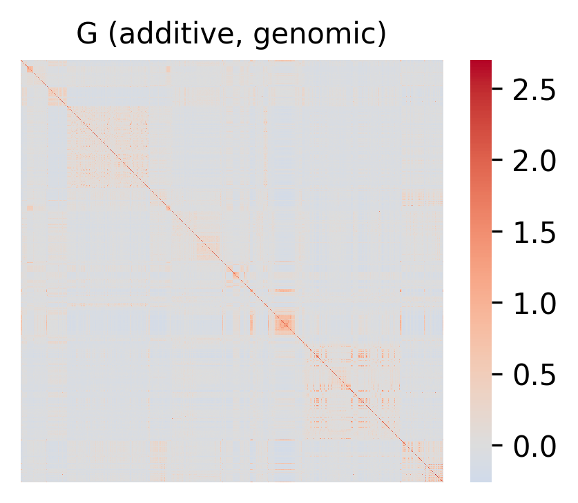
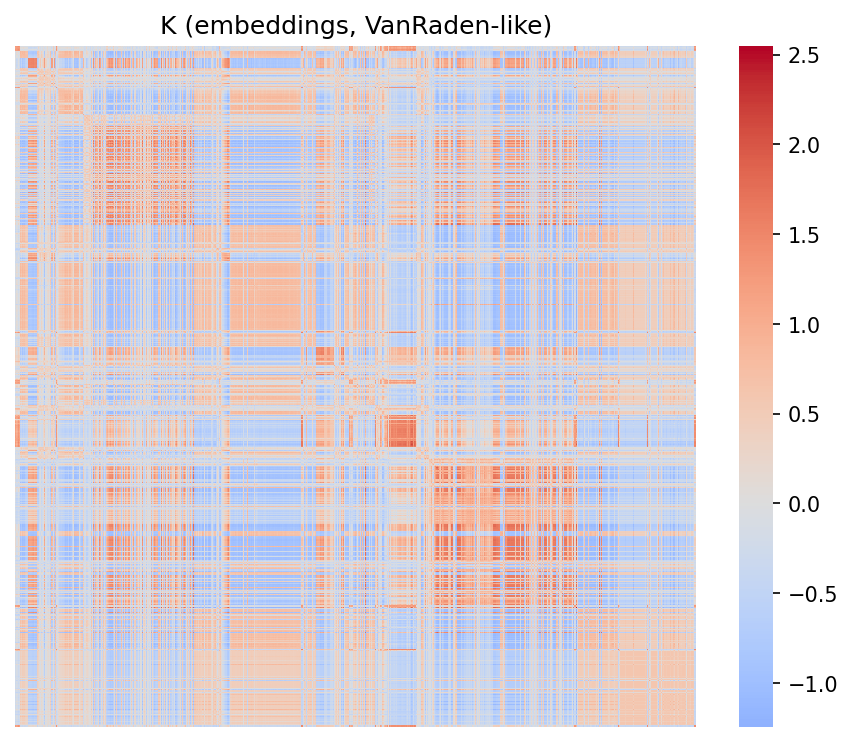

The mixed model compares individuals through their relatedness: either directly read from the genetic similarity (GBLUP, RR-BLUP), or learnt from neural network embeddings (deep kernel).
This page puts these representations side by side and builds the deep kernel intuition step by step: from the genomic kinship and the ridge regression, through the neural network alone, to [m2n2]{.m2n2}.

## Materials and methods

The following representations are computed from the *Arabidopsis thaliana* 1001 Genomes data [@alonso-blanco_1135_2016], packaged by [meiosim](https://github.com/ai-for-genome-interpretation-lab/meiosim).
The genotypes are 10,000 SNPs randomly sampled among those of the RegMap panel [@horton_genome-wide_2012].
The accessions were collected in different countries, the country of origin of each accession defines its group, and its color in the figures.
The phenotype is the days to flowering (DTF1) expressed in a common garden, from the easyGWAS project [@grimm_easygwas_2017].

The neural network used in this example is `ToyNN`, a small network provided with [m2n2]{.m2n2} for didactic purposes.

## Linear genomic model

### Genomic kinship

The genomic kinship is classically computed as:

$$
K = \frac{W W^\top}{\sum_j 2p_j(1-p_j)},
$$

with $W$ the centered markers and $p_j$ the allele frequencies [@vanraden_efficient_2008].
It represents the genetic relatedness between individuals.

::: {#fig-kinship}

Genomic kinship $K$, accessions sorted by country.
:::

This structure can also be observed by a principal component analysis of the SNP matrix.

::: {#fig-kinship-pca}

First three principal components of the genomic kinship $K$, accessions colored by country.
:::

### Ridge regression

The ridge regression on the markers, $y = \mathbf{1}\mu + Wa + r$ with $W$ the centered allele incidence and $a \sim N(0, \sigma^2_a I)$, is equivalent to the GBLUP on $K$.
The weighted alleles $W \odot \hat a$ (with $\odot$ the Hadamard product) decompose the prediction: their row sum is the predicted breeding value.

::: {#fig-ridge}

Principal components of the weighted alleles $W \odot \hat a$ of the ridge regression.
:::

Their principal components remain close to those of the kinship: the effects associated with the markers are estimated as infinitesimal, all small and of similar magnitude, so that they reweight the marker space almost uniformly, and the contrasts between individuals emerge from their sum.

## Neural network

A network trained alone predicts $\hat y = e^\top w + b$, with $e$ the embeddings of its last layer.

::: {#fig-nn-embedding}

Principal components of the embeddings $e$ of the network trained alone.
:::

Entirely built for the prediction, their space collapses to a single dimension, parallel to $\hat y$.
The same pattern is observed for $e \odot w$, whose row sums are $\hat y - b$.

::: {#fig-nn-weighted}

Principal components of the weighted embeddings $e \odot w$ of the network trained alone.
:::

## Mixed model with a neural network

[m2n2]{.m2n2} is a (potentially) deep kernel [@wilson_deep_2016]: the network builds an internal representation $Z_G$, trained on $y$ through the REML, but intermediate.
The mixed model reads it as a covariance, $\sigma^2_G Z_G Z_G^\top$, and sorts the general from the specific.

### Embeddings

::: {#fig-m2n2-embedding}

Principal components of the [m2n2]{.m2n2} embeddings $Z_G$.
:::

Though the 3D view cannot display it fully, the spherical normalization shows, and structures the embedding space.

As for the markers, a kinship is computed from the centered embeddings $Z_c$:

$$
K_Z = \frac{Z_c Z_c^\top}{\sum_j \mathrm{var}(z_j)}.
$$

It is a proximity not in the genome, but in the learnt embeddings.

::: {#fig-m2n2-kinship}

Embedding kinship $K_Z$, accessions sorted by country.
:::

### General weighted embeddings

$Z_G \odot \hat u_G$, whose row sums are the general part of the predicted value.

::: {#fig-m2n2-general}

Principal components of the general weighted embeddings $Z_G \odot \hat u_G$.
:::

Just like the infinitesimal effects of the ridge regression barely alter the marker space, the general embedding effects is reminescent to the embedding space: both views are relatively close.

### Specific weighted embeddings

$Z_G \odot \hat u_{S,k(i)}$, with $k(i)$ the group of individual $i$, whose row sums are the specific part of the predicted genetic value.

::: {#fig-m2n2-specific}

Principal components of the specific weighted embeddings $Z_G \odot \hat u_{S,k(i)}$.
:::

As opposed to the general part, the specific part differs strongly between groups, which are unequally shrunk.
Poorly represented groups are shrunk to 0, while well represented ones receive their own specific embedding effects, accounted for and isolated from the general ones.

### Observations

In this example, the embedding space is mostly shaped by the general part, which only slightly reweights it, but it already "prepares" the specific split: on the sphere, the large groups lie as adjacent sectors, like slices of a melon, that the specific effects pull apart along their own directions.
The slices still overlap, especially on the first principal component of the embedding space: individuals from different groups are spread over a common range, across which the general effects can be estimated.

From a biological point of view, the specific effects represent a $G \times G$ (genotype-by-genotype interaction, or epistasis) component, one $G$ being the genetic specificity of the group, and the other $G$ the whole genetic background. This component is difficult to interpret, and its subtraction aims at improving the model generalisability.

## Beyond genomics

The embeddings do not need to come from markers: any input an encoder can turn into embeddings, such as text, images, sounds or more abstract concepts, defines a relatedness that the mixed model can read.
For instance, embeddings of research paper titles, from a pretrained and frozen transformer, were used in a mixed model to explain their number of citations [@marchal_bayesian_2026].

[m2n2]{.m2n2} goes one step further: the encoder is trained jointly with the mixed model, on the same task.

## References

::: {#refs}
:::
