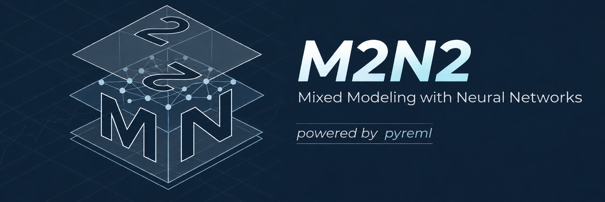

<h1 align="center">

</h1>

<p>
  Mixed modeling with neural networks, built on
  <a href="https://ai-for-genome-interpretation-lab.github.io/pyreml/index.html">
    </a>.
</p>

The random design of a linear mixed model is the embedding of a neural network,
trained jointly with the fixed effects and the variance components on the REML loss.

## Installation

Install [m2n2]{.m2n2} with `pip`:

```bash
pip install m2n2
```

## The model

[m2n2]{.m2n2} fits a linear mixed model built upon `PyTorch` the neural network $\nu$ of parameters $\theta$:

$$
y = X\beta + Zu + r
\qquad
z_i \mapsto \nu(z_i, \theta) \in \mathbb{R}^d
$$

- $y$: a quantitative continuous label, or a list of labels, to be read in the columns of the `pandas` dataframe.
- $X$: the fixed effects design matrix, provided from a `patsy` formula.
- $\beta$: the fixed effects.
- $z_i$: features of individual $i$.
- $Z = \bigoplus_{k=1}^{q} \nu(z_{(k)}, \theta), Z \in \mathbb{R}^{n \times qd}$: the random effects design matrix, or matrix of embeddings, for all $n$ individuals from $q$ distinct groups.
- $u \sim N(0, \sigma^2_u I), u \in \mathbb{R}^{qd}$: the embedding effects, with an embedding effect vector $u_k$ for each of the $q$ groups.
- $r \sim N(0, \sigma^2_R I)$: the residual.

Several random effects based on neural networks can be provided, either referring to the same neural network, the same features, or not.

Additional random effects following the [pyreml]{.pyreml} specification system can also be provided.

## Example

```python
from functools import partial
import numpy as np
import torch
import torch.nn as nn
from meiosim import Arabidopsis
from meiosim.Population import MISSING
from m2n2 import MixedModelNN, Embedding, RandomNN
from pyreml import Random, Residual

pop = Arabidopsis(n_SNPs=10_000, seed=42)
data = pop.phenotypes[["individual", "DTF1"]].merge(
    pop.metadata[["individual", "country"]], on="individual"
)

z = pop.genotypes.astype(np.float32)
z[z == MISSING] = np.nan
z = torch.tensor(np.where(np.isnan(z), np.nanmean(z, axis=0), z))

class Network(nn.Module):
    def __init__(self, z):
        super().__init__()
        self.register_buffer("z", z)
        self.body = nn.Sequential(
            nn.Dropout(0.1), nn.Linear(z.shape[1], 256),
            nn.BatchNorm1d(256), nn.GELU(),
            nn.Dropout(0.5), nn.Linear(256, 128),
            nn.BatchNorm1d(128), nn.GELU(),
            nn.Dropout(0.5), nn.Linear(128, 64),
        )

    def forward(self, rows=None):
        return self.body(self.z if rows is None else self.z[rows])

torch.manual_seed(42)
network = Network(z) # /!\ z and data must be perfectly aligned

model = MixedModelNN(
    data,
    response = "DTF1",
    fixed = "1 + country",
    embedding = {
        "geno": Embedding(network)
    },
    random = [
        RandomNN(
            embedding = "geno",
        ),
        RandomNN(
            embedding = "geno",
            group     = "country",
        )
    ],
    residual = Residual(), # default
)

model.set_optimizer(
    "geno",
    partial( # default
        torch.optim.AdamW,
        lr = 1e-3,
        weight_decay = 1e-1
    )
)

model.set_scheduler(
    "geno",
    None, # default
)

model.fit(
    n_epoch    = 1000,
    batch_size = 256,
    validation = 0.2,
    patience   = 50,
    lr_beta    = 1e-2,
    lr_var     = 1e-2,
)

model.plot()
model.random[0].plot(group_by = "country")
model.random[1].plot()
model.varcomp()

# reset the nn weights
model.reset("geno", seed = 42)
```

## Manual contents

- [Building models](build.qmd)
- [Training models](training.qmd)
- [Deep kernel](deep_kernel.qmd)

## Citation

Please cite this package as:

Marchal, A., Raimondi, D., 2026. m2n2: mixed modeling with neural networks [Computer software]. https://doi.org/10.5281/zenodo.24401053

## Code

The code is available at [this address](https://github.com/ai-for-genome-interpretation-lab/m2n2).

## License

[m2n2]{.m2n2} is distributed with a [GPL-3.0](license.qmd) license.

Copyright © 2026 CNRS, University of Montpellier
