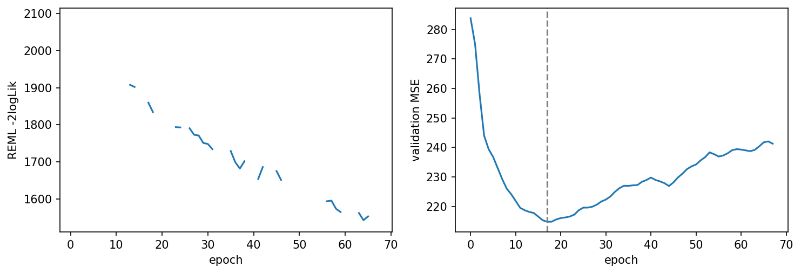

[m2n2]{.m2n2} trains the networks, the fixed effects $\beta$ and the variances jointly, by minibatch gradient descent on the REML loss.
The networks are then frozen, and the mixed model is polished by [pyreml]{.pyreml}.

## The fit method

```python
model.fit(
    n_epoch    = 1000,
    batch_size = None,
    validation = 0.1,
    patience   = 50,
    verbose    = True,
)
```

| Argument     | Meaning                                                                                       |
|--------------|-----------------------------------------------------------------------------------------------|
| `n_epoch`    | Maximum number of epochs. Defaults to 1000.                                                    |
| `batch_size` | Rows per minibatch. Defaults to `None`: full batch.                                            |
| `validation` | Fraction of the labelled rows held out for early stopping. Defaults to `None`: no validation. |
| `patience`   | Epochs without improvement of the validation score before stopping. Defaults to 50, `None` never stops. |
| `verbose`    | Prints the loss and the score at each epoch.                                                   |

The pipeline:

1. REML descent of the network parameters, $\beta$ and the variances, on [minibatches](#minibatches) (see [Loss function](#loss-function)).
2. [Validation](#validation-and-early-stopping) at each epoch, early stopping and restoration of the best state.
3. [Polish](#polish): REML and HMME with the networks frozen, HMME only with `full = False`.

## Loss function

Once the random effects are integrated out, the model reads:

$$
y \sim N\big(X\beta,\ V\big),
\qquad
V = \sum_j Z_j G_j Z_j^\top + R,
$$

with one term $j$ per random effect, and $R$ the covariance of the residual.
For a `RandomNN` term, $Z_j = \bigoplus_{k=1}^{q_j} \nu(z_{(k)}, \theta)$, with $\nu$ the network of its `Embedding` and $q_j$ the number of groups, and $G_j = \sigma^2_{u_j} I$.
For a [pyreml]{.pyreml} `Random` term, $Z_j$ and $G_j$ follow its specification.

The network parameters $\theta$ only enter $V$: like the variances, they are variance parameters, estimated jointly with $\beta$ by restricted maximum of likelihood (REML):

$$
-2\ell_{\text{REML}} = \log\lvert V\rvert
+ r^\top V^{-1} r
+ \log\lvert X^\top V^{-1} X\rvert
+ (n - p) \log(2\pi),
\qquad
r = y - X\beta.
$$

The random effects $u_j$ do not enter the loss: they are predicted afterwards by solving Henderson's mixed model equations (HMME).

### Minibatches

At each epoch, the labelled training rows are shuffled and split into minibatches of `batch_size` rows, the incomplete last batch dropped.
As the embeddings are computed row-wise, the covariance of a minibatch $B$ is the submatrix $V_B$ of $V$, and $y_B \sim N(X_B\beta, V_B)$ exactly: the loss of a minibatch is the REML of the corresponding sub-model.
The observations are not independent: they share the $u_j$, and $V$ is not diagonal.
The minibatch losses therefore do not add up to the full REML: minibatch descent is a stochastic approximation of it, which performs well empirically [@simchoni_integrating_2023].

The loss is computed by [pyreml]{.pyreml}, on the [SMW](https://ai-for-genome-interpretation-lab.github.io/pyreml/training.html#smw) path when the total number of columns of $Z = [Z_1 \mid Z_2 \mid \dots]$ is below $n_B$, on $V_B$ directly otherwise.
The gradient flows by autograd through the variances, $\beta$ and the networks.
Each network is stepped by the optimizer of its `Embedding`, AdamW [@loshchilov_decoupled_2019] by default, and $\beta$ and the variances by Adam [@kingma_adam_2017], at the learning rates `lr_beta` and `lr_var`.
A network shared by several terms is embedded once per minibatch: its gradient gathers the contributions of all of them, and its optimizer steps once.

`model.loss` records the mean minibatch loss of each epoch. It scales with $n_B$: curves are comparable at fixed `batch_size` only.

## Validation and early stopping

Trained on the marginal likelihood, a deep kernel can overfit more severely than a network trained alone [@ober_promises_2021].
For this reason, an early stopping strategy is proposed by [m2n2]{.m2n2}.

With `validation` set, a fraction of the labelled rows is held out once, at random.
At each epoch, the networks in `eval()` mode, the held-out rows $v$ are predicted by their BLUP from the training rows $t$:

$$
\hat y_v = X_v \beta + Z_v G Z_t^\top V_t^{-1} (y_t - X_t \beta),
\qquad
V_t = Z_t G Z_t^\top + R_t,
$$

with $Z = [Z_1 \mid Z_2 \mid \dots]$ and $G$ the block diagonal of the $G_j$. Their mean squared error is recorded in `model.score`.

The best state (weights of every network, $\beta$, variances) is kept. Training stops after `patience` epochs without improvement, and the best state is restored.
Without `validation`, training runs `n_epoch` epochs and the last state is kept.

Each validation solves a dense system in $V_t$, of size $n_t \times n_t$.

The held-out rows, the minibatches, the network initializations and the dropout masks all draw from the PyTorch generator: `torch.manual_seed` makes the training reproducible.

## Polish

The networks are frozen in `eval()` mode and the embeddings computed once.
The model is then a linear mixed model with a known random design, refitted by [pyreml]{.pyreml} on every labelled row, held-out ones included:

- [REML](https://ai-for-genome-interpretation-lab.github.io/pyreml/training.html#reml) re-estimates $\beta$ and the variances, by L-BFGS with its adaptive convergence criterion;
- [HMME](https://ai-for-genome-interpretation-lab.github.io/pyreml/training.html#hmme) gives the BLUE of $\beta$, the BLUP of every $u_j$, and their error variances.

Both run in double, as the whole mixed model.
With `full = False` (see [Building models](build.qmd#the-from_dataframe-constructor)), the REML is skipped: HMME runs on the variances at the end of training (restored state with `validation`).

## Monitoring

| Accessor                    | Content                                                    |
|-----------------------------|------------------------------------------------------------|
| `model.loss`                | Mean minibatch REML loss at each epoch.                    |
| `model.score`               | Validation MSE at each epoch, empty without `validation`.  |
| `model.opti_REML.loss`      | REML loss at each iteration of the polish.                 |
| `model.opti_REML.converged` | Whether the polish met the convergence criterion.          |
| `model.opti_REML.duration`  | Wall-clock time of the polish, in seconds.                 |

The `opti_REML` accessors are not set with `full = False`.

### Training curves

Training behavior on a small example:

<p align="center"></p>

The validation MSE rises once the networks overfit; the dashed line marks the restored epoch, from which the [polish](#polish) is run.

## References

::: {#refs}
:::
